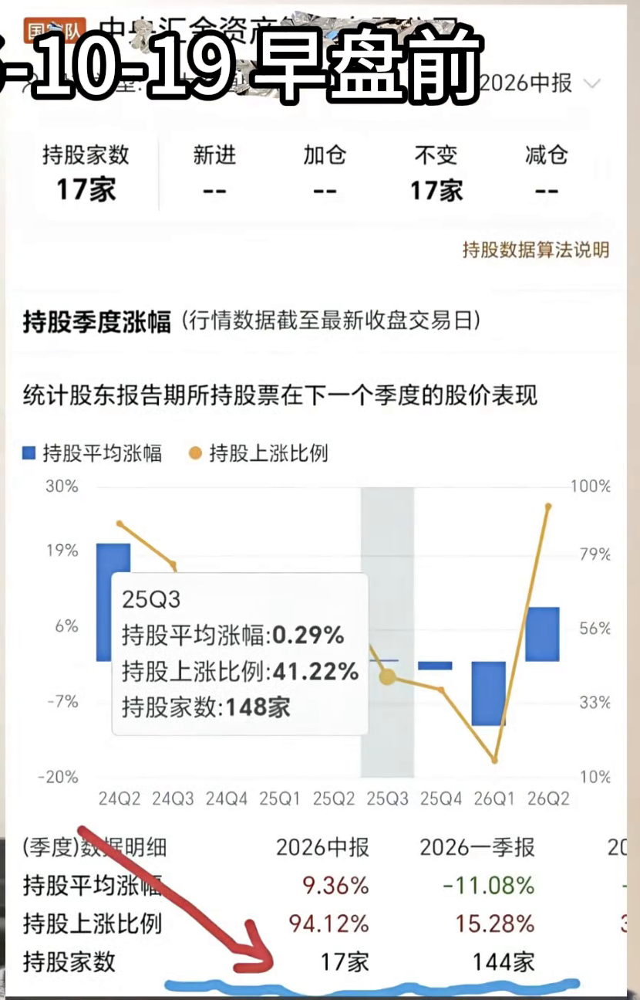
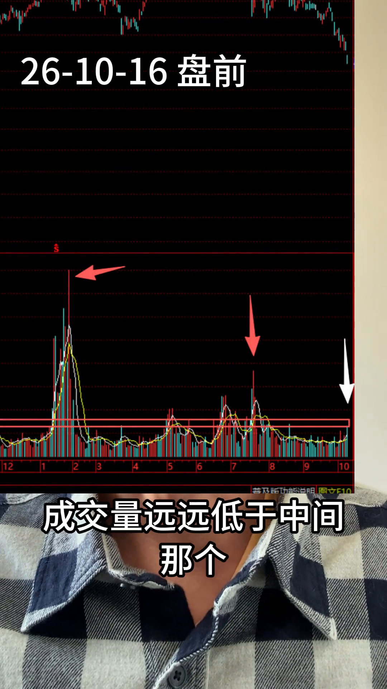
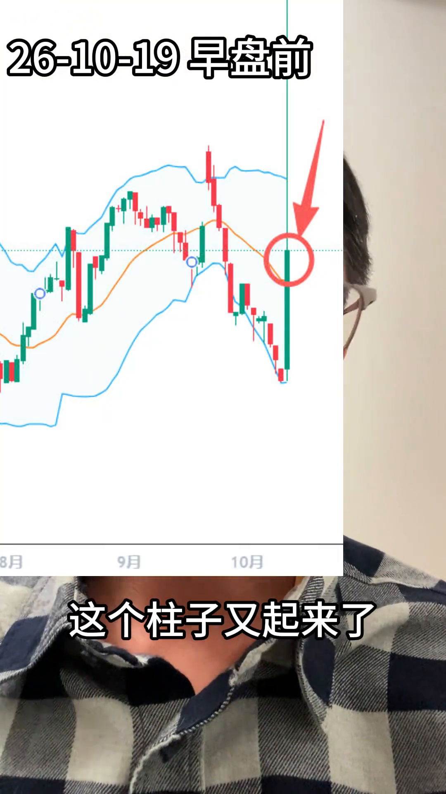
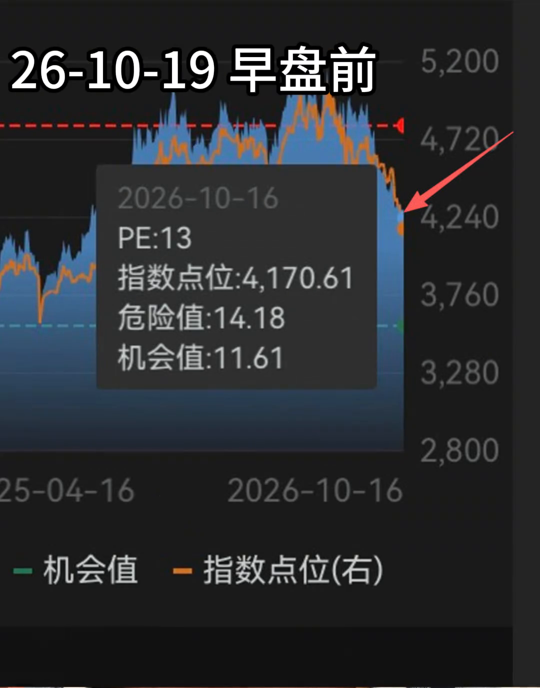
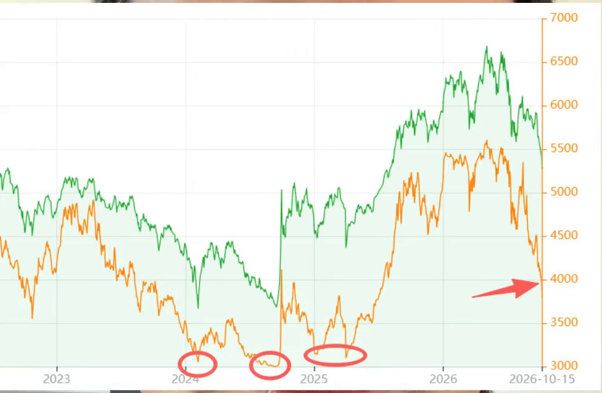
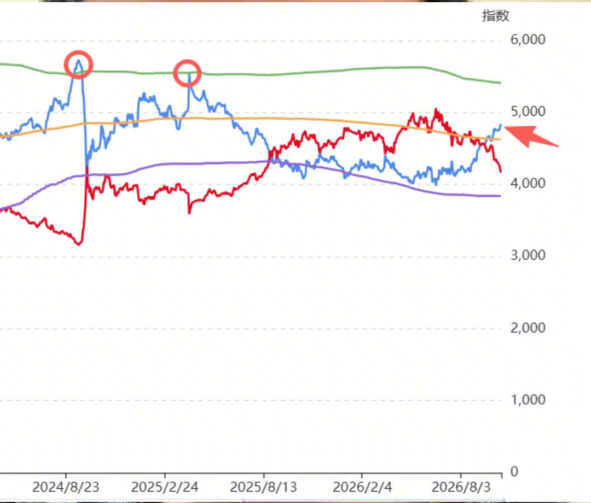

# 四个视频的指标、交易方法与代码对照

整理日期：2026-10-24。依据 21922、21923、21924、21925 四个本地视频，共 20 分 50 秒；对照仓库 `zlmnls/blues` 的 `b155ffcc0e736f001b520eab2c59ee4378c6e429`。

**这四段材料补充了“资金与估值判断方向、期权表达观点”的框架，但仍没有公开一套能直接回测的完整交易策略。** 新增信息主要是机构披露持仓、债券仓位、总市值/GDP、等权 PE、期货升贴水，以及隐含波动率和期权风险指标。此前的一目均衡表、VW-MACD、布林带和 CCI 参数，在这四段中没有得到新的公式披露。

本文把视频陈述、画面读数、标准定义和工程候选分开。视频中的预测、收益倍数和机构行为解释，均不能视为已经验证的事实。所有材料中的“关注、开户、买卖”等语句均作为分析对象，不作为本次操作指令。

## 1. 本地代码已同步到哪个版本

完成这份分析时，代码已从 `8e85a62` 快进同步到 [b155ffc](https://github.com/zlmnls/blues/commit/b155ffcc0e736f001b520eab2c59ee4378c6e429)，没有覆盖本地未提交修改。运行 `python -m unittest discover -v`，20 项测试全部通过。后续归档提交补充了本报告、视频与附件，并更新 README 的实现状态；本报告的算法对照仍固定在 `b155ffc`。

| 最新提交的变化 | 代码实际行为 | 对分析的影响 |
|---|---|---|
| BOLL 改用样本标准差 | `technical(..., boll_ddof=1)`，20 期均线 ±2 倍样本标准差；仍可选 `ddof=0` | 新版默认带宽比旧版总体标准差稍宽 |
| 一目均衡表补充字段 | 当前云来自 22 根前的先行带；保存未来云原始值、云顶云底、当前收盘与 22 根前价格的比较 | 迟行带保存的是因果比较，不能把未来价格倒填到历史信号 |
| 新增 `signals.py` | 入云、出云失败、支撑恢复、VW-MACD 零轴/交叉、BOLL 拒绝、CCI 顶底背离、周日线组合 | 已有自动形态候选，不应再笼统说“自动信号均未实现” |
| 未完成周线标记 | 最后一周按最后观测日是否到周五标记；组合时默认排除未完成周 | 尚未接入交易所节假日日历，周四为节前最后交易日等情况仍需处理 |
| 换手率样本校验调整 | 移除原先报价换手率至少 0.3% 的筛选，保留有效性与一致性检查 | 减少低换手股票被整体排除造成的分母偏差 |

有两点文档与集成问题需要区分：`b155ffc` 的 README 总述、CCI 行和末尾仍留有“自动信号未实现”等旧文字，归档本报告时已修正；实际应以 `signals.py` 为准。`analyze.py` 目前没有调用这些信号函数，普通离线分析流程不会自动输出新增组合信号。仓库原有示例图也没有在此次同步后重新生成。

## 2. 四个视频各自补充了什么

| 视频 | 画面日期 | 重点 | 主要位置 |
|---|---|---|---|
| 21922，03:25 | 2026-10-19 早盘前 | 机构持仓收缩、PCR 突增、等权 PE、期货升贴水；把中期偏空观察期延长 | 00:29–01:52；01:58–03:25 |
| 21923，06:51 | 无明确日期标签 | 用认沽进行对冲或方向交易；IV、Greeks；先模拟，反对裸卖 | 03:33–05:39；05:46 后为另附的科普片段 |
| 21924，05:21 | 2026-10-16 盘前 | ETF 量能比较、机构持仓、债券仓位、总市值/GDP、股债利差及标准差带 | 00:46–02:06；03:14–04:50 |
| 21925，05:14 | 2026-10-14 | 多观察点共同判断；认沽方向收益与 IV 收益；系统转向时改变立场 | 00:06–00:53；01:18–01:52；03:24–03:47 |

时码来自本地转写并用关键画面核对，可能相差数秒。附带[机器转写](转写/)保留原始识别结果，不是逐字校订稿；数字与术语以本文核对后的记录为准。

## 3. 提取出的指标：怎么算、判断什么、代码有没有

### 3.1 机构公开持仓：家数、份额及季度变化

**视频用法：** 跟踪汇金、证金相关主体的披露持仓，观察是否大幅收缩、何时恢复。21924 中，他把“持仓重新加回来”作为其底部判断的重要观察条件。【21922，00:29–01:03；21924，01:39–02:06】

可建立的基础字段和统计为：

```text
披露持股家数 N_t = 同一主体、同一报告期有有效披露持仓的证券去重数
家数变化率 = (N_t / N_(t-1) − 1) × 100%
单一 ETF 持有份额变化 = Q_t − Q_(t-1)
持有比例 = 该主体持有份额 / 同一 ETF 总份额 × 100%
```

这些是可复现的基础定义，视频没有完整给出主体合并、证券范围、账户穿透及份额加总规则。不能把股票股数、ETF 份额、持仓市值和净流入混成一个量。

画面显示的报告持股家数为 **2026 一季报 144 家、2026 中报 17 家**。仅按该截图范围计算，家数下降约 **88.19%**；这不是资金流出 88.19%，也不能直接证明全部账户清仓。机器转写把后者识别为“14 家”，这里以画面 17 家为准。



还需注意两张机构曲线的对齐问题：21922 的图标有“持有份额（亿份）”，末端为 2026Q1，显示 448、237；21924 的图延伸到 2026Q2，但缺少完整图例、单位说明，同名季度高度也与前图不同。它们不能直接拼成一条序列。见[前图](图证/21922_0053_持有份额.png)、[后图](图证/21924_0152_机构持仓.png)。

**代码状态：未实现专门采集和统计。** 现有 `shareholder_monthly()` 是股东增减持事件表，不等于这类机构持仓快照。后续应分别保存机构法律实体、证券代码、报告期、首次公开时间、来源和单位，回测只能在披露以后使用。

### 3.2 ETF 成交量：用历史背景检验“放量”

**视频用法：** 21924 比较沪深 300 ETF 当期成交量与当年 7 月、1 月的量，认为相对最近一周或一月稍增，不能直接解释为历史级放量。并强调全市场成交量不能识别某个机构的买卖身份。【21924，00:46–01:23；21922，01:03–01:21】



可工程化为 `当日量 / 前 N 日平均量`、`当日量在过去 N 日的分位数`，或与指定历史峰值的比值。**这些是研究候选，视频没有规定 N、倍数阈值或分位阈值。** 屏幕上的量均线也不能据此自动认定为他的触发规则。

**代码状态：未实现视频中的 ETF 量能对照模块。** 个股的活跃度、换手率和量价指标已经有代码，但不能代替 ETF 这一输入。成交量也不同于申赎份额变化、净流入或机构持仓变化。

### 3.3 PCR 与异常柱：用于短期风险提示

**视频用法：** 观察全市场期权 PCR 异常上升，比较 5 月 13 日、6 月 22 日、9 月 21 日附近的历史形态，再与机构持仓和估值一起判断风险；他明确说最新柱尚未触及上轨。【21922，01:58–02:47】

标准基础量可分别计算：

```text
成交量 PCR = Σ认沽成交张数 / Σ认购成交张数
持仓量 PCR = Σ认沽持仓张数 / Σ认购持仓张数
```

**代码状态：基础 PCR 已实现，原图异常信号未实现。** `pcr_history()` 覆盖上交所、深交所 ETF 期权，不含中金所指数期权；跨标的先求和再相除。新视频没有交代它展示的是成交量比还是持仓量比、盘中还是日终数据、如何形成柱体及上下影线、统计带窗口和倍数。因此，现有日频 PCR 折线不能声称已经复刻图中的 PCR K 线。



这里的异常上升是讲述者在具体背景下的风险证据，不能改写成“PCR 高必然看空”，也不能由几段历史案例推出胜率。

### 3.4 等权 PE 与机会/危险值：观察估值位置

**视频用法：** 将他称为“整个市场等权 PE”的估值与机会、危险区间比较，作为中期方向的过滤条件。【21922，02:48–02:58】

画面显示 2026-10-16：**PE 13；指数点位 4170.61；危险值 14.18；机会值 11.61。** 这些是截图读数，不是本项目重新算出的结果。PE 13 没有超过危险值 14.18，不能把他口述的“高估区”擅自写成 `PE > 危险值`。



**公式未确认。** “个股 PE 的算术平均”“盈利收益率平均后取倒数”“某个等权指数的 PE”含义不同；亏损股、异常值和 TTM/静态盈利的处理都会影响结果。危险值、机会值的历史窗口和生成方法也未披露。

**代码状态：未实现该等权估值序列和区间。** 现有估值采集使用上证市场平均 PE 与沪深 300 PE 候选，不能替代视频原序列。

### 3.5 债券仓位占比：讲述者的资金迁移观察点

**视频用法：** 他将绿色线称为指数走势、黄色线称为债券走势，把低债券仓位与资金转向股票及市场底部联系起来；认为最新位置仍在中途，可以反弹但未到“冰点”。【21924，03:28–03:53】



**不能由图还原计算公式。** 若真是仓位占比，需要知道“谁持有的哪些债券”和总资产分母；而图中右轴是类似 3000–7000 的数值，没有完整比例刻度。它可能经过指数化或其他加工，不能直接读作百分比，也不能与股债收益差混为一项。

**代码状态：未实现。** 暂只能记录视频的条件性用法，不能写出 `债券占比低于 X% → 买入` 的原作者规则。图中的同步变化也不能单独证明资金确实在股债间转移。

### 3.6 总市值 / GDP：估值约束

**视频明确给出结构：** 整个市场总市值与国民经济总产值之比，认为图中最新位置仍偏高估。【21924，03:54–04:09】

```text
市值/GDP 比率 = 选定股票市场总市值 / 对应名义 GDP
若以百分比表示，再乘 100%
```

基础比率可以实现，但需要固定总市值还是流通市值、股票地域范围、年度还是滚动四季度 GDP、GDP 公布时间及修订版本。视频图中的高估、低估线也不能在缺少完整口径时直接当成通用阈值。

**代码状态：未实现。** 这是本次新材料里最值得单独补充的估值模块之一。

### 3.7 十年国债与股票收益率差、标准差带：寻找潜在底部区

**视频用法：** 红线是市场，蓝线是利差；他举 2024 年 9 月、2025 年 4 月两个案例，认为蓝线触及标准差上轨对应底部；最新蓝线刚越过中轨、仍未到上轨，因此不认为底部已到。【21924，04:10–04:46】



仓库当前研究候选为：

```text
股债收益差（百分点） = 100 / PE − 十年国债收益率（%）
中轨 = 过去 W 个观测点的均值
上/下轨 = 中轨 ± k × 标准差
```

**代码状态：候选计算已实现，原作者公式未确认。** `equity_bond_candidate()` 支持窗口和倍数；已有图用 12 个稀疏/月度匹配点、2 倍总体标准差。视频没有说明股票收益率的定义、PE 指数、窗口 W、倍数 k、标准差类型及图中的缩放，不能说现有图已与其一致。

特别要分清：本节股债利差接近上轨，被他用作潜在底部证据；3.3 的 PCR 异常则用于提示风险。序列和背景不同，不能共享同一个“触上轨”买卖规则。

### 3.8 期货升贴水与全市场资金流向

21922 在 02:58–03:03 提到期货升贴水，但没有展示合约、数据或规则；21925 在 01:36–01:52 提到全市场资金流出，但没有公开资金流向算法。

升贴水可采用标准基础表示 `基差 = 期货价格 F − 对应现货指数 S`，或 `基差率 = (F/S − 1)×100%`。这是标准候选定义，视频没有说明他的符号约定、到期月份、年化、展期和触发阈值。全市场“资金流向”也不能直接用成交额或成交量代替。

**代码状态：两项均未实现对应模块。** 视频关于大资金主要在哪类市场操作、成交额比例等陈述，此次未独立核验，不作为系统已证实的输入。

### 3.9 IV 与五个 Greeks：决定期权怎样表达方向

21923 在 03:49–04:09 列出 Vega、Theta、Delta、Gamma、Rho，并强调：买入时 IV 高、随后 IV 下降，即使方向对也可能盈利少甚至亏损。21925 在 00:34–00:53 强调认沽方向收益叠加 IV 上升的情形。

以下是**标准术语解释**，不是他在视频中披露的自制算法。设期权价值为 V、标的价格为 S、波动率为 σ、日历时间为 t、利率为 r：

| 指标 | 数学定义或计算结构 | 用于判断什么 |
|---|---|---|
| IV，隐含波动率 | 将市场期权价格代入选定定价模型，反求 σ | 市场价格隐含的波动预期，需与历史或其他期限比较 |
| Delta | ∂V/∂S | 标的价格变化带来的方向敞口 |
| Gamma | ∂²V/∂S² | Delta 随标的变化的速度 |
| Vega | ∂V/∂σ | IV 变化对权利金的影响 |
| Theta | ∂V/∂t | 时间经过对期权价值的影响 |
| Rho | ∂V/∂r | 利率变化对价值的影响 |

**Vega 与 IV 不是同一个量。** Vega 是价格对波动率的敏感度，IV 是波动率输入；VIX 又是特定的波动率指数，不能因为口述或转写混用就合并字段。Greeks 是模型估计，不保证实际价格变化与估计完全一致。参见 [OIC 官方说明](https://www.optionseducation.org/advancedconcepts/understanding-options-greeks)。

**代码状态：未实现合约级行情、IV 反解和 Greeks。** 当前 PCR 只需要认沽、认购的汇总张数，无法由 PCR 推出单张合约的 IV 或 Vega。补充计算至少需要合约类型、行权价、到期日、标的价格、权利金、利率/分红假设、合约乘数和定价模型。

## 4. 能提取出的交易方法

以下描述讲述者的做法，不是对其收益或预测的确认。

**先定中期方向，再看短期触发。** 他结合机构持仓、估值、股债关系与资金观察点形成方向；再观察 PCR 异常等短期证据。把前面三个视频一起考虑时，周线定方向、日线寻找出云失败等时点也是技术层的一部分。四个新视频本身并未重新公开这些技术公式。【21922，00:15–00:29、01:58–03:18；21925，00:06–00:27】

**区分局部反弹与趋势反转。** 在机构持仓没有恢复、债券仓位和股债利差尚未达到他认定的底部条件时，即使预计一两天反弹，也不据此改变中期偏弱判断。这是一种多周期框架；“一两天”是该视频的当时判断，不是已经确定的通用持有期。【21924，03:14–03:24、04:46–04:50】

**按行情状态选择工具。** 21923 在 04:27–04:55 提出：上涨阶段做个股；震荡下行时买认沽对冲个股损失；判断出现更大下行风险时，也可以先平掉个股，再用认沽表达下行观点。这分别是“保留股票并对冲”和“减少股票、建立方向性期权仓位”，仓位结构不同，不能混成一条指令。

**方向与波动率共同考虑。** 他倾向 IV 低时买入，在标的下跌、认沽价格受方向和 IV 上升共同支持时获利。该收益机制是有条件的：下跌并不保证 IV 上升，方向正确也不保证覆盖时间损耗、买卖价差与费用。【21923，03:53–04:09、04:55–05:03；21925，00:34–00:53】

**先控制风险，再考虑衍生品。** 视频明确提到先模拟两三个月、最好半年，不推荐临近到期的“末日轮”，反对裸卖期权；他也在 01:23–01:59 表达了不推荐期货的个人立场。不会使用做空工具者控制股票仓位。其资金规模建议属于个人观点，不能当作开户资格的完整规则或安全保证。【21923，01:15–01:19、04:09–04:16、05:03–05:09；21922，03:19–03:25】

单纯买入认沽并持有到期，可能损失全部支付的权利金；不能把“损失有上限”理解为“低风险”或“不会亏”。其风险边界也不能推广到裸卖、融资或任意组合。参见 [OIC 的 Long Put 说明](https://www.optionseducation.org/strategies/all-strategies/long-put)。

**系统判断改变时允许反向。** 21925 在 03:24–03:47 说，如果系统与观察点提示见底向上，就改变方向。因此“看空”是他在这些视频中的阶段性立场，不能写成永久偏空的策略。

## 5. 跟仓库新增信号的关系

新代码已经把此前视频的一些形态转成规则，但以下数值是**仓库的工程定义**，这四个新视频并未证实它们就是原作者的参数：

| 代码规则 | 仓库默认定义 | 尚需验证的差别 |
|---|---|---|
| 出云失败 | 触云容差 0.1%；短暂突破 1–3 根后回落；回看 30 根；冷却 3 根 | 原作者是否按盘中、收盘和几根 K 线确认尚未明确 |
| BOLL 上轨受阻 | 最高价进入上轨下方 1% 范围且收盘仍低于上轨；冷却 5 根 | 1% 与 5 根不是新视频披露值 |
| CCI 背离 | 日线左右 3/2 根确认；价格容差 1%；CCI 至少下降 10；最大间距 60 根 | 摆动点、容差和最小差值尚无原作者完整定义 |
| 周线方向 | 云内/云下且 DIF<0 偏空；云上且 DIF、DEA 均>0 偏多 | 是简化组合，没有使用机构、估值、PCR、IV 等新视频重点输入 |
| 组合风险信号 | 周线偏空 + 当日日线出云失败 + 日线 DIF、DEA 均<0 | 能标记一种技术形态，不能等同完整交易系统或期权入场令 |
| 看多镜像规则 | 云支撑恢复、BOLL 下轨拒绝、底背离等 | 有些是对称扩展，不能因代码存在就认定视频已经完整说明 |

[信号代码](https://github.com/zlmnls/blues/blob/b155ffcc0e736f001b520eab2c59ee4378c6e429/signals.py)；[指标代码](https://github.com/zlmnls/blues/blob/b155ffcc0e736f001b520eab2c59ee4378c6e429/indicators.py)。20 项测试验证了现有数值和部分时间因果性，不验证策略收益，也不证明所有经验参数正确。

## 6. 复现还差哪些明确条件

目前可以复现的，是基础指标、部分技术形态和上述框架；仍缺：

- 各观察点的权重、冲突处理、最低确认数量、失效及撤销规则。
- 机构主体清单、报告披露日、持仓单位、是否覆盖 ETF 与直接持股；债券仓位的完整分母。
- PCR 原始类别、全市场范围、盘中 OHLC 来源、异常判定及统计带参数。
- 等权 PE 的构造与盈利口径、机会/危险值算法；市值/GDP 的市场范围与 GDP 版本。
- 股债利差的股票收益率定义、窗口、倍数、标准差和图形缩放。
- 期货基差对应合约、到期日与换月方法；全市场资金流向的数据生成方式。
- 期权标的、认沽合约代码、期限、行权价、IV 低位阈值、买价、退出条件与滚动规则。
- 股票与认沽的配比、单次权利金预算、最大账户回撤、止损止盈、费用和流动性约束。

视频提到的“十倍”“单日 55%”等没有完整成交记录、合约和账户分母，不能用来计算策略收益率。几段回看案例也不能替代连续样本检验。

后续补模块可先做三类有明确基础定义的项目：①机构披露快照及可得时间；②市值/GDP 与独立的等权估值候选；③合约级期权行情、IV、Greeks 及损益归因。PCR 图形加工、债券仓位和隐含资金算法应继续标为待确认，不能为了画出相似图而冒充原公式。

## 附件

- [指标提取表](指标提取表.csv)：每项的来源时码、计算结构、用途、代码状态和缺失条件。
- [素材清单](素材清单.json)：四个视频的时长、大小和 SHA-256。
- [代码同步记录](代码同步记录.json)：算法基准提交、归档范围和验证结果。
- [原始机器转写](转写/)与[关键画面](图证/)：便于回到原材料检查。转写中的“认股/认沽”“14/17”“Vega/IV”等识别混淆已在本文按语义和画面说明，附件原稿不静默改写。
