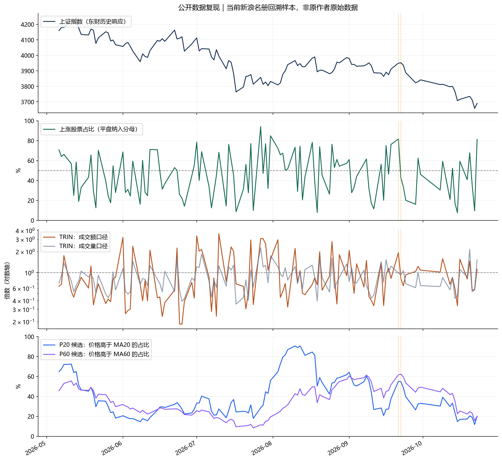
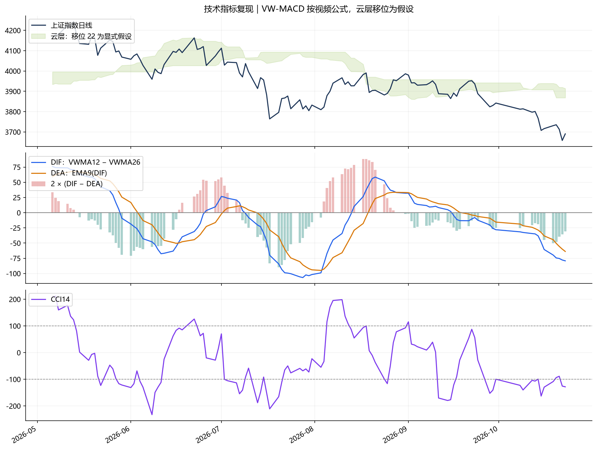
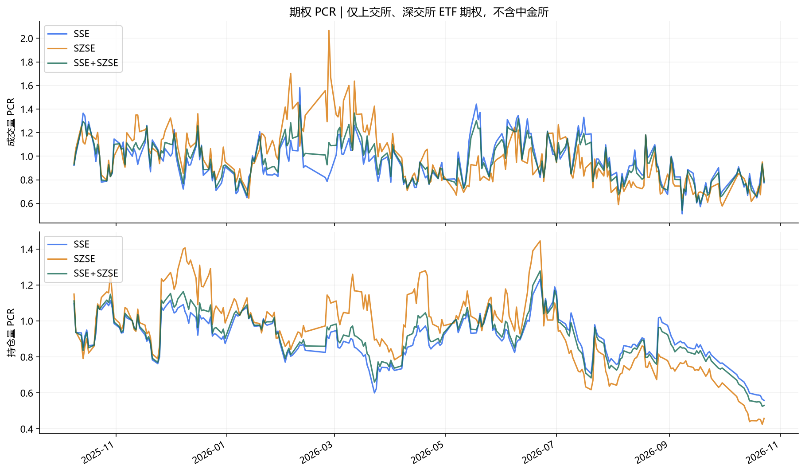
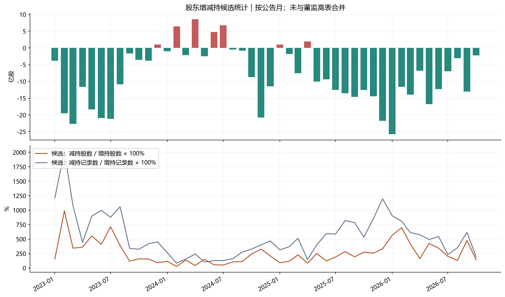
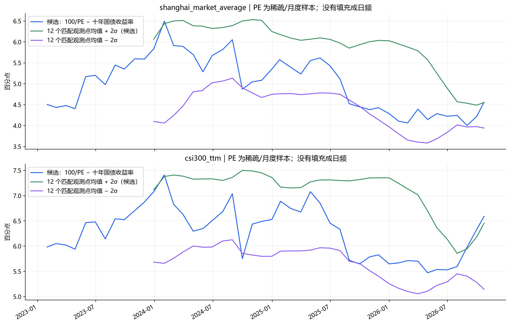

# 2026-10-23 示例结果

这些文件是已经计算好的汇总示例，可以直接阅读，不需要联网采集。

| 文件 | 内容 |
|---|---|
| [snapshot_metrics.json](snapshot_metrics.json) | 当次快照的涨跌家数、TRIN 和高换手占比 |
| [market_breadth.json](market_breadth.json) | 253 个交易日的广度、TRIN、P20/P60 和 MCL 候选 |
| [natural_scope_comparison.json](natural_scope_comparison.json) | 沪深京与仅沪深两种自然范围下的历史案例比较 |
| [video_comparison.json](video_comparison.json) | 沪深京主样本与视频口述数值的差异 |
| [quality_report.json](quality_report.json) | 覆盖率、单位校准、缺失情况及假设 |

## 样本说明

取得当前新浪名册中 5,576 只股票的历史数据，回溯范围从 2025-10-01 开始。某个交易日的有效样本数取决于当时是否上市、是否活跃和数据是否完整。

市场广度图采用沪深京主样本，README 中案例表单独展示沪深口径；两种结果都在 JSON 中保留。原视频统计范围未完全确认，不能将接近的数值视为已经精确还原。

完整逐股输入、原视频和请求缓存没有提交到仓库，不能仅凭这里的汇总结果重新计算全部指标。全量重算需先运行根目录的采集脚本，再运行 `analyze.py`。

## 图表

市场广度和量价结构；P20/P60 为候选定义：

VW-MACD 与其他技术指标；云层移位为假设：

成交量、持仓量两种 PCR；仅含上交所、深交所 ETF 期权：

股东增减持候选，按公告月统计：

股债差候选，使用稀疏/月度 PE 和 12 个匹配观测点统计带：

